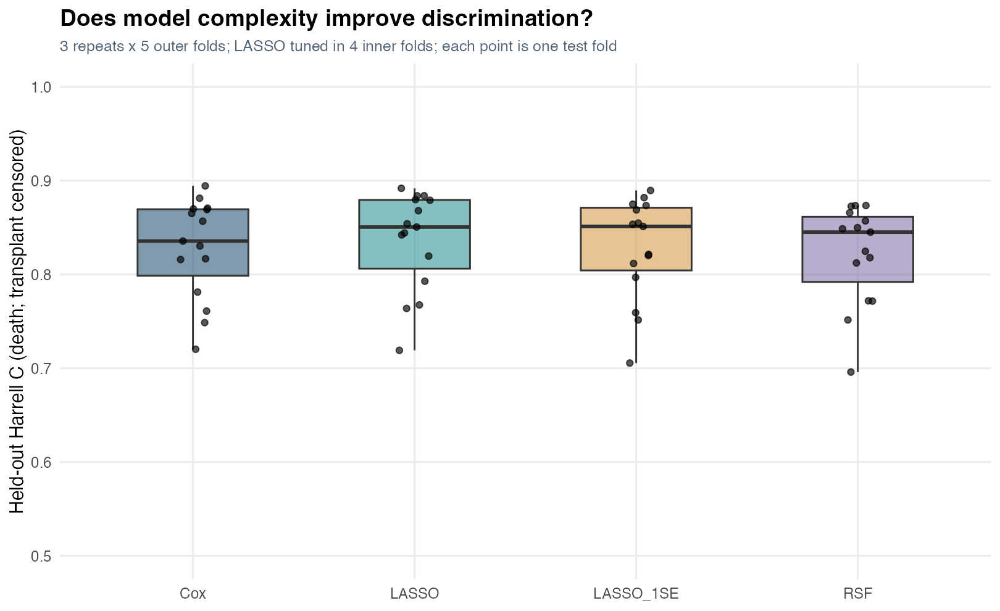
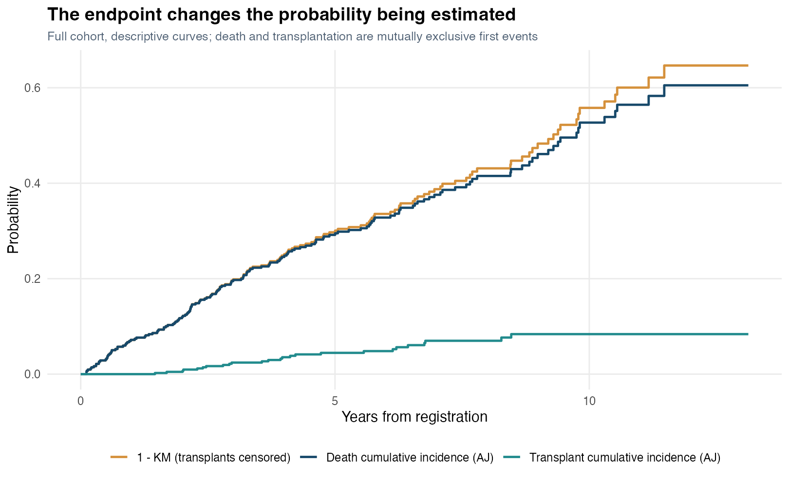

# PBC Survival Analysis: Validation, Stability and Competing Events

**Question:** In a small clinical cohort, does increasing model complexity produce an improvement that is stable across data partitions?

This extension revisits a collaborative course study of primary biliary cholangitis (historically called primary biliary cirrhosis). It replaces a single train/test comparison with repeated nested evaluation and distinguishes cause-specific discrimination from the cumulative incidence of death in the presence of transplantation.



## Analysis design

The extension uses all 418 records in `survival::pbc`, including 312 randomized participants and 106 additional participants. This documented data version is not asserted to be byte-for-byte identical to the missing original Kaggle CSV.

1. Create three independent seeded, status-stratified five-fold partitions.
2. Fit median/mode imputation on each outer training set. Apply predefined `log1p` transforms to skewed biomarkers. Use an explicit feature allowlist; exclude record ID, follow-up, outcome and treatment assignment.
3. Compare a prespecified six-variable Cox model, LASSO Cox, the LASSO one-SE rule and a random survival forest with fixed settings. The Cox predictors are age, sex, bilirubin, albumin, prothrombin time and edema. LASSO/RSF use 16 clinical predictors; therefore the comparison also varies feature set, not only algorithm.
4. Tune LASSO penalties by mean C-index in four inner folds. Refit imputation within every inner training fold. The one-SE rule is a parsimony heuristic; fold-based standard errors are not inferential confidence intervals.
5. Compute Harrell C on each outer test fold, with larger risk scores explicitly oriented toward shorter survival. Calculate selection frequency across outer fits. Any risk boundaries are fitted on training scores, then applied only to held-out patients.
6. Show full-cohort Aalen-Johansen cumulative incidence for death and transplantation alongside `1 - KM` with transplants censored. Check the proportional hazards assumption descriptively.

The evaluation endpoint is time to death with transplantation censored. These C-indices do not measure calibrated real-world death probability. Aalen-Johansen curves estimate a different, competing-event probability; they are descriptive and are not out-of-sample model validation.

## Run and inspect

From the repository root:

```sh
Rscript projects/pbc-survival/run.R
Rscript tests/validate.R --results
```

Read [the result interpretation](projects/pbc-survival/RESULTS.md), [outer fold metrics](projects/pbc-survival/results/fold_metrics.csv), [paired split differences](projects/pbc-survival/results/paired_split_differences.csv), [selection stability](projects/pbc-survival/results/selection_frequency.csv) and [PH diagnostics](projects/pbc-survival/results/ph_diagnostic.csv).



## Scope and limitations

The small historical, single-center cohort and incomplete nontrial measurements limit generalization. Single imputation ignores uncertainty in the missing values and may conceal informative missingness; treatment is excluded because its absence marks nontrial enrollment. We do not fit a joint model for the missingness process. No external validation is available. Harrell C depends on the censoring pattern. Repeated folds overlap, so their range and spread describe split sensitivity rather than independent replicates or a confidence interval. The forest is a fixed benchmark rather than an exhaustively tuned competitor. PH diagnostic signals require further study of time-varying effects.

Future work would assess time-varying effects, multiple imputation within resampling, competing-risk prediction with calibration at fixed horizons, and validation in a separate cohort. These are proposed extensions, not completed results.

Original team: Yuexi Dai, Xinrui Yu and Mengting Qiu, STAT 486, Fall 2025. The maintained extension was prepared with AI coding assistance; see [contributions](CONTRIBUTIONS.md).

## Environment and provenance

Use R 4.4.1. Install dependencies with `Rscript scripts/install.R`; `renv.lock` records the completed local run. Exact restoration on a clean machine has not been verified. Regenerate the readable result summary with `python3 scripts/build_reports.py`. See [data sources](DATA_SOURCES.md), [validation record](docs/REPRODUCIBILITY.md) and [methodological audit](docs/METHODOLOGICAL_AUDIT.md).
