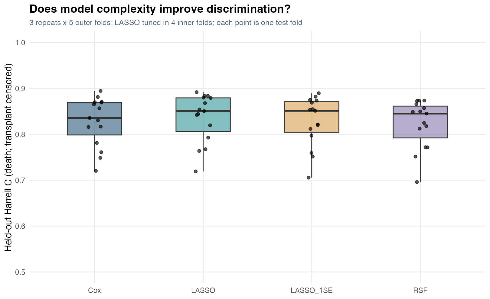
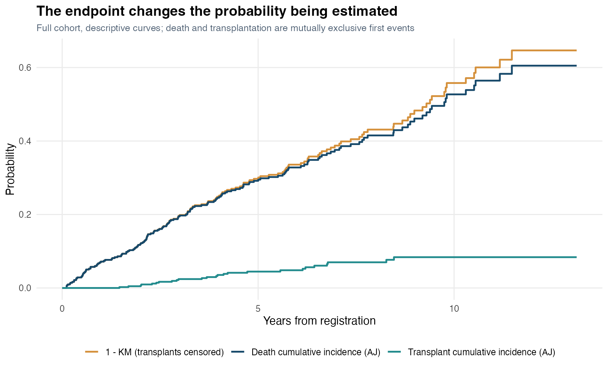

# PBC extension results

These are executed extension results from `survival::pbc`, not a reproduction of the missing course CSV. The cohort has 418 records: 232 administratively censored, 25 transplants and 161 deaths.

## Repeated outer-fold discrimination

| Model | Mean C | Fold SD | Minimum | Maximum |
| --- | --- | --- | --- | --- |
| Cox | 0.8278 | 0.0532 | 0.7203 | 0.8945 |
| LASSO | 0.8360 | 0.0527 | 0.7191 | 0.8919 |
| LASSO_1SE | 0.8277 | 0.0544 | 0.7055 | 0.8896 |
| RSF | 0.8222 | 0.0528 | 0.6959 | 0.8736 |

Each value summarizes 15 test folds from three repetitions of five-fold evaluation. The SD describes split variation, not an inferential standard error. LASSO uses four inner folds with imputation refitted in each training fold. The Cox model has six prespecified clinical predictors; LASSO and the fixed-parameter forest use the broader 16-feature set.

LASSO has the largest mean C, with an average paired advantage over Cox of about 0.0082. Its paired split differences vary in sign. The one-SE LASSO is close to Cox, and the forest does not improve the mean in this experiment. This is evidence of modest, split-sensitive differences, not established algorithmic superiority or clinical benefit.

## Competing-event probability

At five years, full-cohort Aalen-Johansen death cumulative incidence is **29.17%**, transplant cumulative incidence is **4.46%**, and `1 - KM` with transplants censored is **29.71%**. The estimands differ even when the numerical gap is small. These curves are descriptive; they do not validate calibrated individual death predictions.

## Model checking

The full-cohort descriptive Schoenfeld-residual diagnostic has global p = **0.0377** and prothrombin-time p = **0.0049**. This suggests investigating time-varying effects rather than assuming the Cox structure is adequate. These are exploratory, unadjusted diagnostic tests after single imputation, not a final inferential analysis.

## Defensible conclusion

The most useful extension is a validation design that separates model development from evaluation and makes the prediction target explicit. Small apparent gains need to be assessed against split sensitivity, missing-data assumptions and model diagnostics. No external validation, multiple imputation or time-varying model was completed.

